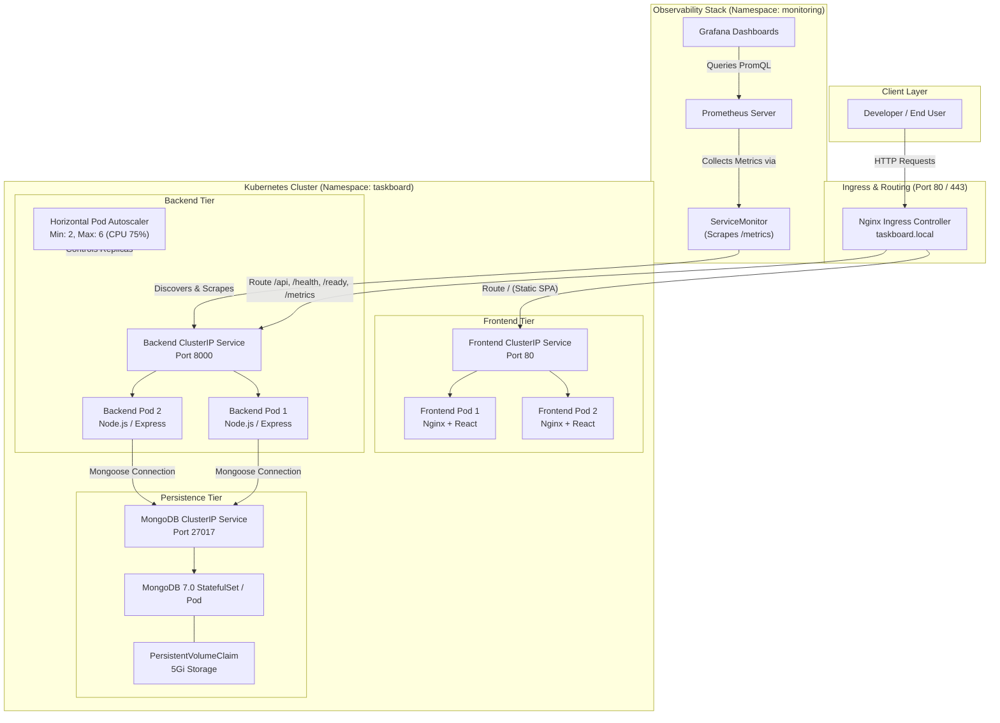
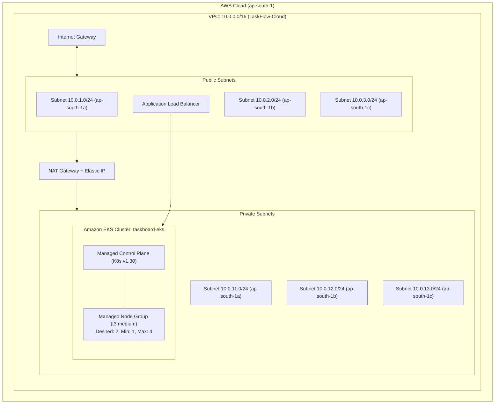
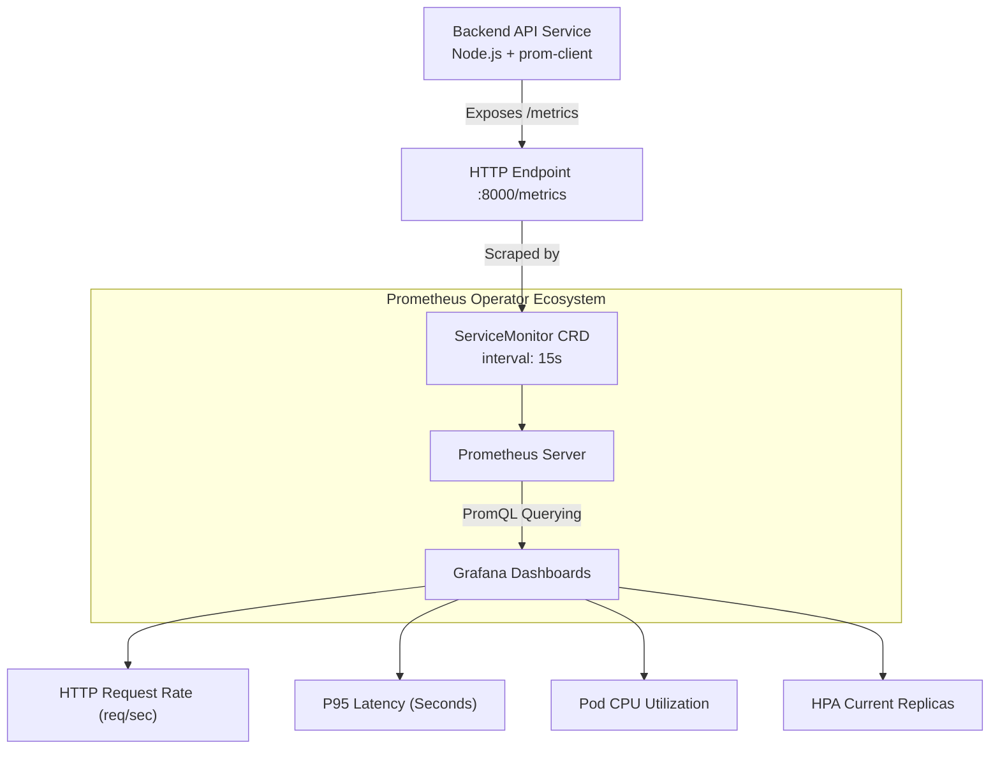

# TaskFlow Cloud — Architecture Specification

This document provides a detailed overview of the system architecture, infrastructure design, continuous delivery pipelines, and observability model for the **TaskFlow Cloud** platform.

---

## 1. High-Level Architecture Diagram

---

## 2. Component Architecture

### A. Frontend Layer
- **Framework:** React 18, Vite, Lucide React icons, Vanilla CSS design system.
- **Packaging:** Multi-stage Docker build:
  1. *Build Stage:* `node:20-alpine` runs `npm run build` to compile the Single Page Application.
  2. *Runtime Stage:* `nginx:1.27-alpine` serves optimized static HTML, JavaScript, and CSS assets.
- **Reverse Proxy:** Embedded Nginx configuration handles local API proxying (`/api` $\rightarrow$ `backend:8000`) and operational probes (`/health`, `/ready`).
- **Security:** Runs as an unprivileged, non-root user.

### B. Backend API Layer
- **Framework:** Node.js (v20) and Express REST API framework.
- **Key Modules:**
  - `taskRoutes.js`: Full CRUD endpoints (`GET`, `POST`, `PUT`, `DELETE`) with request validation.
  - `opsRoutes.js`: Exposes `/health` (liveness), `/ready` (dependency check on MongoDB), and `/metrics` (Prometheus exposition).
  - `metrics.js`: Collects default process metrics (CPU, memory, event loop lag) and custom HTTP duration histograms via `prom-client`.
- **Security:** Runs inside container as unprivileged `nodejs` user (`UID 1001`).

### C. Database Layer
- **Engine:** MongoDB 7.0 (Jammy).
- **Persistence:** Mounted onto persistent storage volume (`5Gi`) to ensure zero state loss across pod restarts and deployments.
- **Connectivity:** Accessed strictly through internal Kubernetes ClusterIP DNS (`mongodb://taskboard-mongodb:27017/taskboard`).

---

## 3. DevOps & CI/CD Pipeline Architecture

```mermaid
flowchart LR
    Dev([Developer]) -->|Git Commit & Push| GH[GitHub Repository]
    
    subgraph GitHubActions ["GitHub Actions Automation Engine"]
        T[Job 1: Automated Tests<br/>Jest & Supertest]
        Sec[Job 2: Container Security<br/>Aqua Trivy Vulnerability Scan]
        Build[Job 3: Docker Build<br/>Multi-Stage Build Engine]
        Pub[Job 4: Publish GHCR<br/>Tagged with Commit SHA]
    end

    subgraph GHCR ["GitHub Container Registry"]
        Pkg[ghcr.io/shreesha-codes/taskflow-cloud/*]
    end

    subgraph DeployPhase ["Cluster Deployment Phase"]
        Helm[Helm Upgrade & Install]
        K8s[Kubernetes Cluster]
    end

    GH -->|Webhook Trigger| T
    T -->|On Pass| Sec
    Sec -->|No High/Critical CVEs| Build
    Build --> Pub
    Pub --> Pkg
    Pkg -.->|Pull Image by SHA Tag| Helm
    Helm --> K8s
```

1. **Quality Gate:** Jest regression tests execute automatically. Any unit or integration failure immediately halts the build.
2. **DevSecOps Gate:** Aqua Security Trivy scans both frontend and backend images for OS and application package vulnerabilities. Builds fail on unpatched `HIGH` or `CRITICAL` severity CVEs.
3. **Immutability:** Docker images are tagged with the specific Git commit SHA (e.g., `sha-a2327a0`) rather than mutable `latest` tags, guaranteeing reproducible deployments.

---

## 4. Cloud Infrastructure Architecture (Terraform AWS)

- **VPC & Subnets:** Isolated multi-AZ design spanning 3 availability zones with dedicated public and private subnet pairs.
- **Compute:** Amazon EKS cluster with private worker nodes in managed node groups to isolate compute workloads from direct public exposure.
- **Network Security:** Public subnets route egress through an Internet Gateway; private subnets route outbound traffic securely through a NAT Gateway.
- **IAM Policies:** Granular IAM execution roles attached to control plane and worker nodes with least-privilege policies (`AmazonEKSClusterPolicy`, `AmazonEKSWorkerNodePolicy`, `AmazonEKS_CNI_Policy`).

---

## 5. Observability & Telemetry Model

- **Metrics Collection:** Prometheus scrapes the `/metrics` endpoint every 15 seconds via declarative Kubernetes `ServiceMonitor` resources.
- **Visualization:** Pre-configured Grafana dashboards provide operational visibility into request throughput, latency distribution, backend CPU load, and horizontal pod autoscaler (HPA) replica scaling.
