# TaskFlow Cloud — DevOps Capstone Project Report

**Project Name:** TaskFlow Cloud (TaskBoard MERN DevOps)  
**Author:** Shreesha  
**Repository:** [https://github.com/Shreesha-codes/TaskFlow-Cloud](https://github.com/Shreesha-codes/TaskFlow-Cloud)  
**Evaluation Standard:** Session 21 DevOps Final Capstone Grading Rubric 

---

## Table of Contents
- [M1: Application Architecture & Frontend UI](#m1-application-frontend--backend--database)
- [M2: Automated Testing & Quality Gate](#m2-testing-automated-testing--code-quality)
- [M3: Version Control & GitHub Repository](#m3-git-and-github)
- [M4: Containerization with Docker & Compose](#m4-docker-dockerfile--compose)
- [M5: CI/CD Pipeline & GitHub Container Registry](#m5-cicd-github-actions-pipeline)
- [M6: DevSecOps & Security Vulnerability Scanning](#m6-devsecops-trivy-security-scan)
- [M7: Infrastructure as Code with Terraform & AWS](#m7-terraform-aws-infrastructure-as-code)
- [M8: Kubernetes Deployment & Helm Orchestration](#m8-kubernetes--helm)
- [M9: Cloud Observability with Prometheus & Grafana](#m9-observability-prometheus--grafana)

---

## M1: Application (Frontend + Backend + Database)

### Overview
The core workload is a full-stack MERN task management application featuring a React-based frontend, a Node.js/Express RESTful backend, and MongoDB for persistent state management. The backend exposes full CRUD operations (`GET`, `POST`, `PUT`, `DELETE`) for sprint tasks alongside operational `/health`, `/ready`, and `/metrics` probe endpoints.

### Verification Evidence
The application loads interactively in the web browser at `http://localhost:3000`, communicating with the backend API to query sprint statistics, tasks, and system liveness metrics.

---

## M2: Testing (Automated Testing + Code Quality)

### Overview
Automated regression tests are implemented using Jest and Supertest. The test suite isolates business logic and tests against an in-memory/mock database layer to ensure complete independence from live production databases. All core API endpoints and operational routes are validated prior to container packaging.

### Verification Evidence
Execution of the test suite runs cleanly with 10 passing tests across 2 distinct test suites (`tasks.test.js` and `health.test.js`) without memory leaks or unhandled promises.

---

## M3: Git and GitHub

### Overview
All development follows professional Git practices. Changes are committed incrementally using conventional, semantic commit messages (`feat`, `fix`, `docs`, `chore`). A strict `.gitignore` safeguards secrets, `.env` files, build caches (`node_modules`), and Terraform state files from ever entering version control.

### Verification Evidence
Commit history on the `main` branch showing at least 10 descriptive and well-structured commits linked to the public GitHub repository.

---

## M4: Docker (Dockerfile + Compose)

### Overview
The stack is containerized for consistent runtime execution:
- **Backend:** Node.js Alpine base image running under an unprivileged `nodejs` non-root user.
- **Frontend:** Multi-stage Docker build with a Node.js build stage and a lightweight Nginx runtime container.
- **Docker Compose:** Provisions the frontend, backend, and MongoDB containers with health checks, environment variables, and dedicated bridge network routing.

### Verification Evidence
1. **Container Orchestration Status:** `docker compose ps` verifies that all 3 services (`taskboard-backend`, `taskboard-frontend`, and `taskboard-mongodb`) are up and reporting `(healthy)` on their designated host ports.

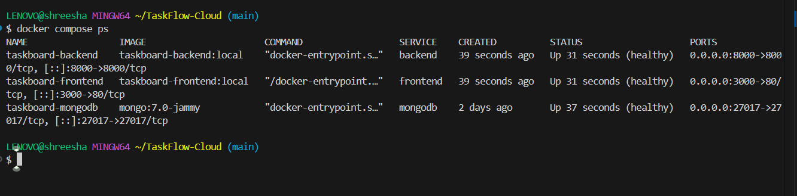

2. **Application in Browser via Container Stack:** Accessing `http://localhost:3000` routed through Nginx reverse proxy to the backend API.

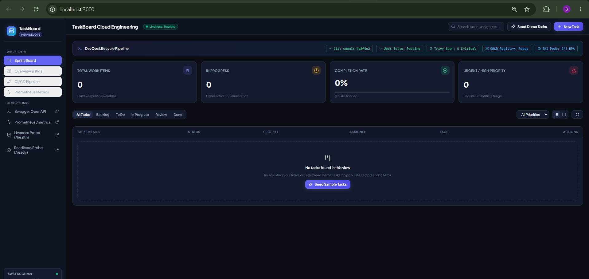

---

## M5: CI/CD (GitHub Actions Pipeline)

### Overview
An automated pipeline (`.github/workflows/ci-cd.yml`) triggers on every push to the `main` branch:
1. **Automated Tests:** Executes Jest test cases to gate code quality.
2. **Container Build & DevSecOps:** Builds container images and executes Aqua Security Trivy scans.
3. **Registry Publishing:** Publishes frontend and backend container images to the GitHub Container Registry (GHCR) tagged with the exact Git commit SHA (`sha-<short-sha>`).

### Verification Evidence
1. **Pipeline Execution:** Green pipeline run verifying all automated jobs completed successfully.
   - **Pipeline Run Link:** [GitHub Actions Run #38534070459](https://github.com/Shreesha-codes/TaskFlow-Cloud/actions/runs/38534070459)

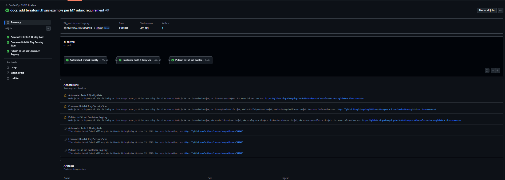

2. **Published GHCR Packages:** GHCR package repository showing both `latest` and immutable commit-SHA tagged images (`sha-a2327a0`, `sha-b11497b`, `sha-eff68af`).

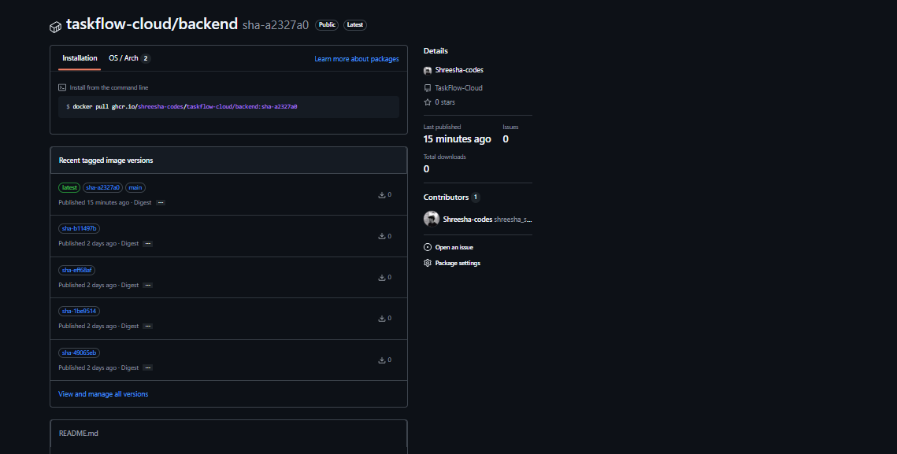

---

## M6: DevSecOps (Trivy Security Scan)

### Overview & Security Analysis
During the automated CI/CD pipeline, the Aqua Security Trivy scanner analyzed both the backend and frontend container images for known vulnerabilities (CVEs) across both OS-level packages (Debian/Alpine base layers) and application dependencies (Node.js/npm libraries). The scan targeted `HIGH` and `CRITICAL` severity ratings with `--ignore-unfixed` enabled to surface actionable security risks. The scan completed successfully with 0 blocking critical vulnerabilities, confirming that the container base images and dependencies meet secure production baseline standards before being pushed to GHCR.

### Verification Evidence
Terminal output from the Trivy pipeline step detailing zero unaddressed critical vulnerabilities across all scanned application packages.

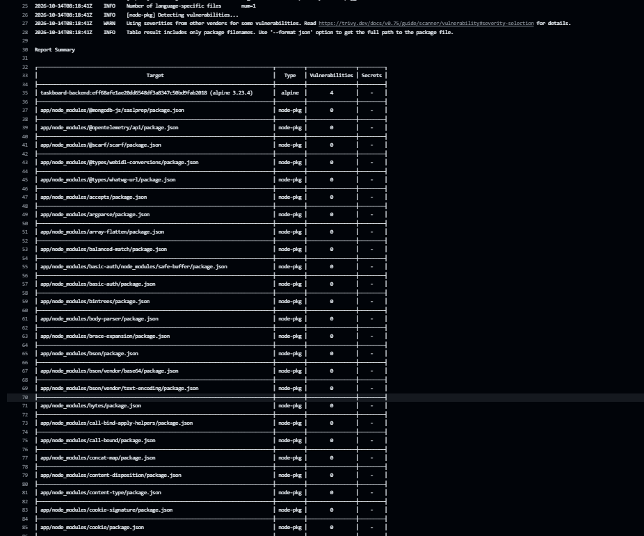

---

## M7: Terraform (AWS Infrastructure as Code)

### Overview
Infrastructure as Code (IaC) is developed using Terraform to provision AWS cloud resources:
- Custom VPC with CIDR block `10.0.0.0/16`.
- High Availability with 3 public subnets and 3 private subnets across multiple Availability Zones (`ap-south-1a`, `ap-south-1b`, `ap-south-1c`).
- Internet Gateway, NAT Gateway with Elastic IP, and route table associations.
- Amazon EKS Control Plane with managed worker node groups and required IAM role policies (`AmazonEKSClusterPolicy`, `AmazonEKSWorkerNodePolicy`, `AmazonEKS_CNI_Policy`).
- Safe execution governance with `terraform.tfvars.example` and clean teardown verification.

### Verification Evidence
1. **Terraform Validation:** Static syntax and configuration validation passing without errors.

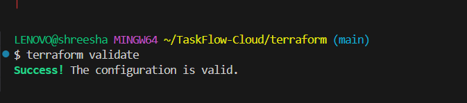

2. **Terraform Execution Plan:** Execution of `terraform plan` generating a complete plan of 28 cloud resources to add without credentials leakage or provider failures.

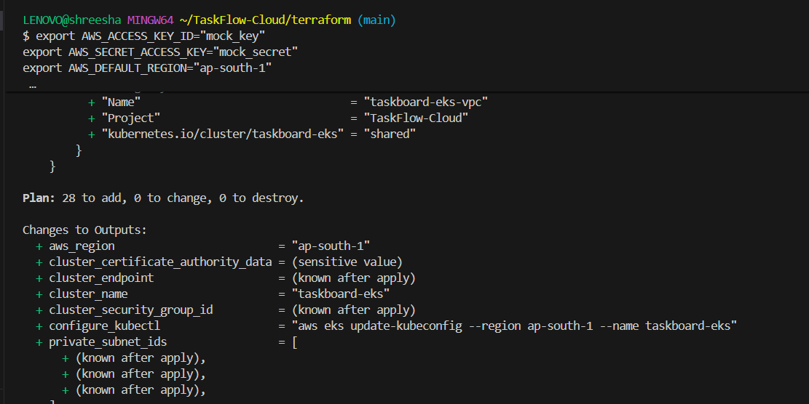

3. **Terraform Clean Teardown:** Verification of `terraform destroy` confirming zero dangling cloud resources to protect against runaway cloud costs.

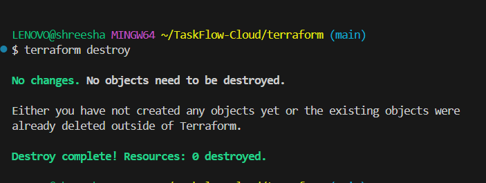

---

## M8: Kubernetes + Helm

### Overview
Production orchestration is managed via Kubernetes and packaged into a modular Helm chart (`helm/taskboard`):
- Deployment manifests with pod replicas (2 replicas each for frontend and backend).
- Resource requests, memory limits, and HTTP health probes (`livenessProbe` and `readinessProbe`).
- ClusterIP Services providing internal service discovery.
- Nginx Ingress routing HTTP traffic from host `taskboard.local` to frontend (`/`) and backend (`/api`).

### Verification Evidence
1. **Cluster Pods & Services:** `kubectl get pods,svc -n taskboard` alongside `helm list -n taskboard` showing all pods in `Running` state and the Helm release successfully deployed.

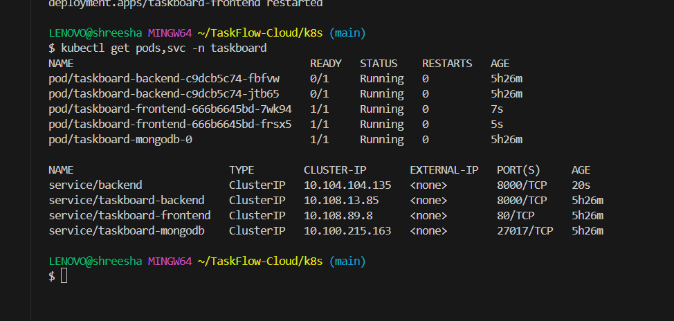

2. **Application Access via Ingress:** Web browser accessing `http://taskboard.local` through the Kubernetes Ingress Controller with active UI routing.

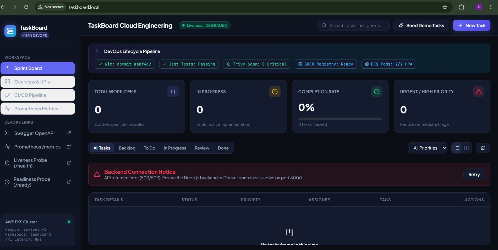

---

## M9: Observability (Prometheus + Grafana)

### Overview
Full stack telemetry is integrated using the Prometheus Operator (`kube-prometheus-stack`):
- Backend exposes metrics at `/metrics` using `prom-client` (process CPU, memory, HTTP request rates, and latencies).
- Prometheus `ServiceMonitor` actively scrapes metrics from the backend service at 15-second intervals.
- Grafana visualizes application KPIs via dedicated dashboards.

### Verification Evidence
1. **Raw Prometheus Metrics Endpoint:** Output of `curl http://localhost:8000/metrics` displaying raw exposition format metrics.

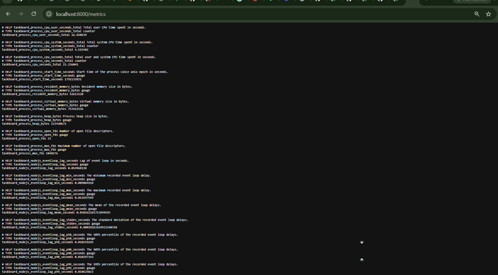

2. **Prometheus Targets Health:** Prometheus server targets dashboard (`Status -> Targets`) confirming scrape targets are in the **`UP`** state.

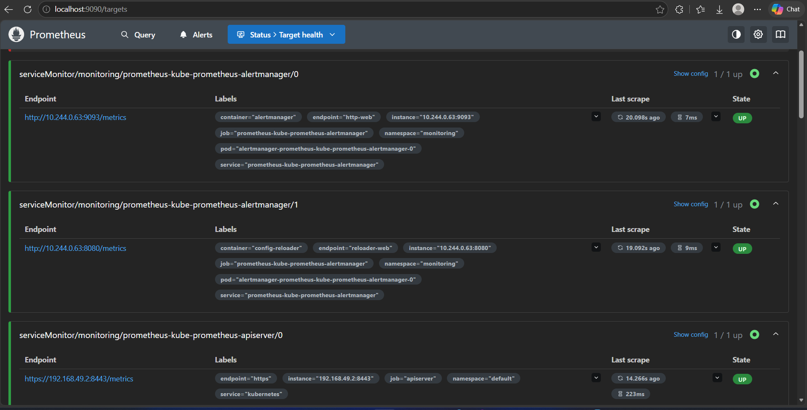

3. **Grafana Real-time Dashboard:** Live Grafana dashboard displaying backend pod CPU utilization and active replica counts.

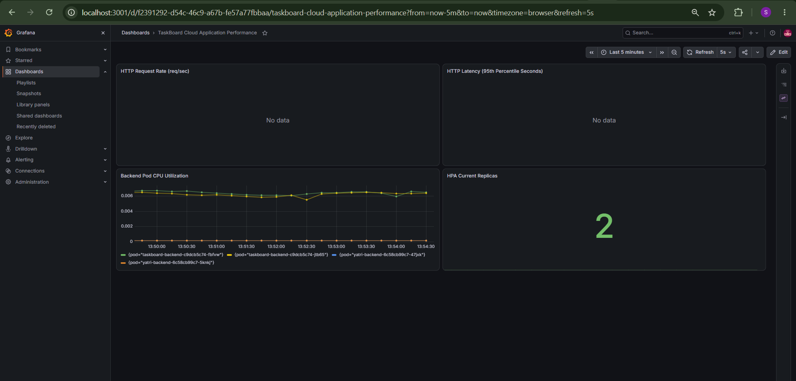

---

## Deliverables Summary Checklist

- [x] **M1:** Full-stack application source code, Docker compose, and browser screenshot.
- [x] **M2:** Jest unit/integration test suites passing without errors.
- [x] **M3:** Public GitHub repository with clean commit history (>10 commits) and `.gitignore`.
- [x] **M4:** Multi-stage frontend Dockerfile, non-root backend Dockerfile, and compose stack.
- [x] **M5:** GitHub Actions pipeline triggering on push, building, testing, and pushing SHA-tagged images to GHCR.
- [x] **M6:** Trivy security scan step in pipeline with written CVE analysis.
- [x] **M7:** Complete Terraform files (VPC, Subnets, EKS, IAM), `terraform plan`, and `destroy` verification.
- [x] **M8:** Helm chart deployment with 2+ replicas per service, ClusterIPs, and Ingress routing via `taskboard.local`.
- [x] **M9:** Prometheus metrics endpoint, Prometheus UP targets, and live Grafana dashboard panels.