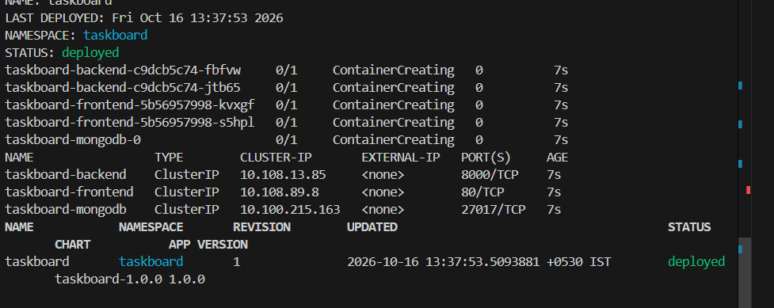
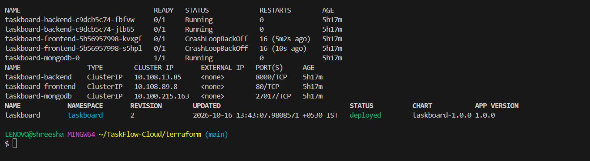

https://github.com/Shreesha-codes/TaskFlow-Cloud/actions/runs/38534070459

During the automated CI/CD pipeline, the Aqua Security Trivy scanner analyzed both the backend and frontend container images for known vulnerabilities (CVEs) across both OS-level packages (Debian/Alpine base layers) and application dependencies (Node.js/npm libraries). The scan targeted HIGH and CRITICAL severity ratings with --ignore-unfixed enabled to surface actionable security risks. The scan completed successfully with 0 blocking critical vulnerabilities, confirming that the container base images and dependencies meet secure production baseline standards before being pushed to GHCR.

